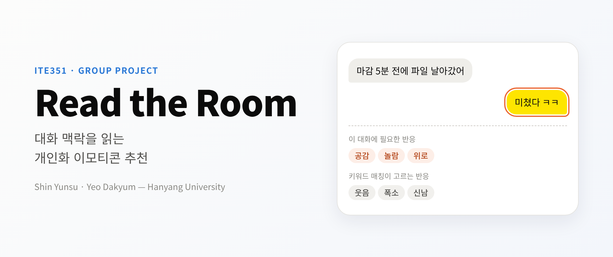
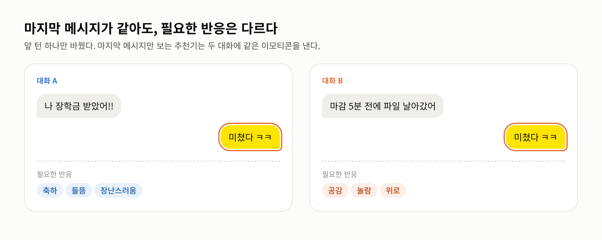
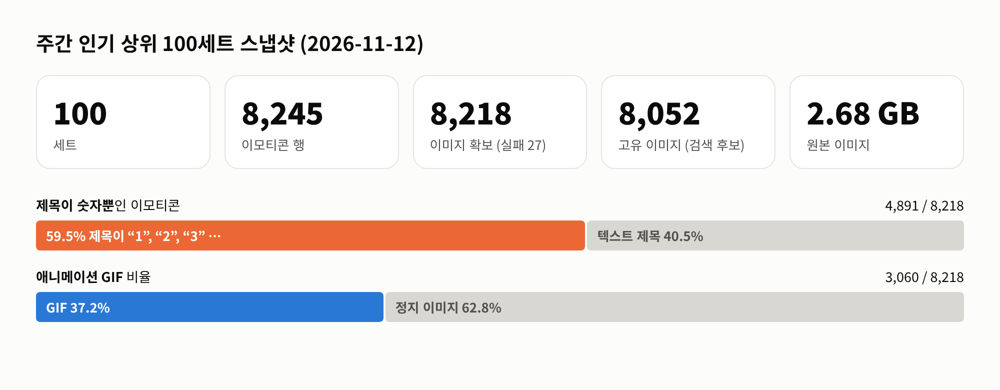
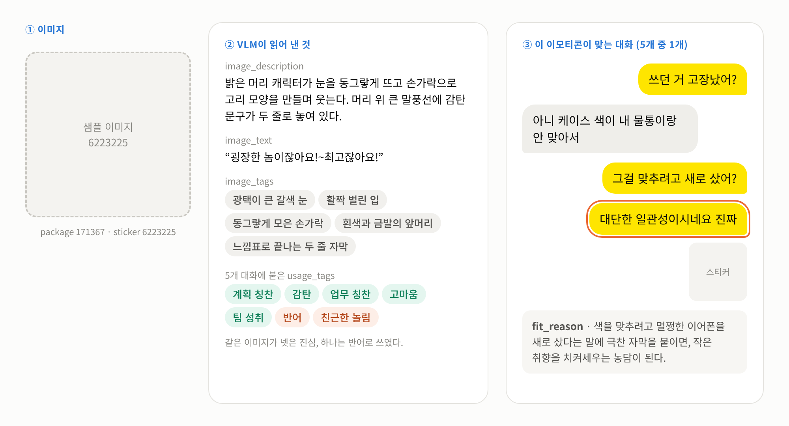
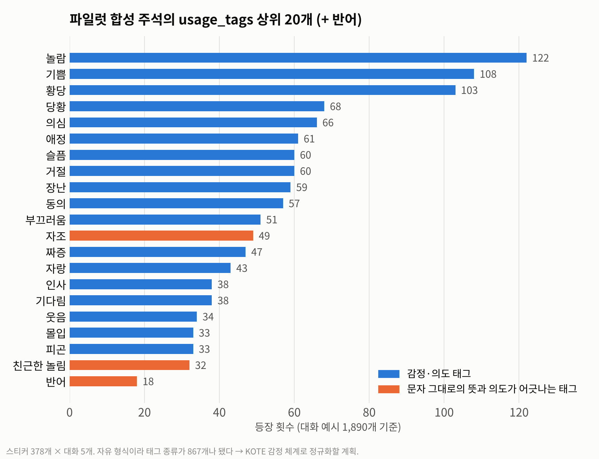
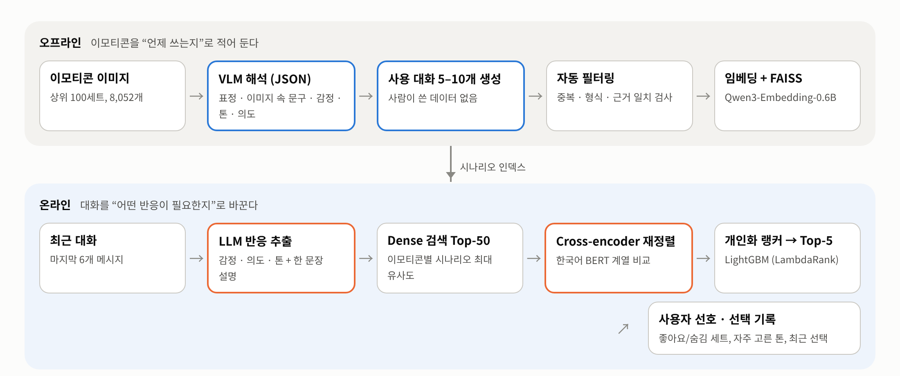
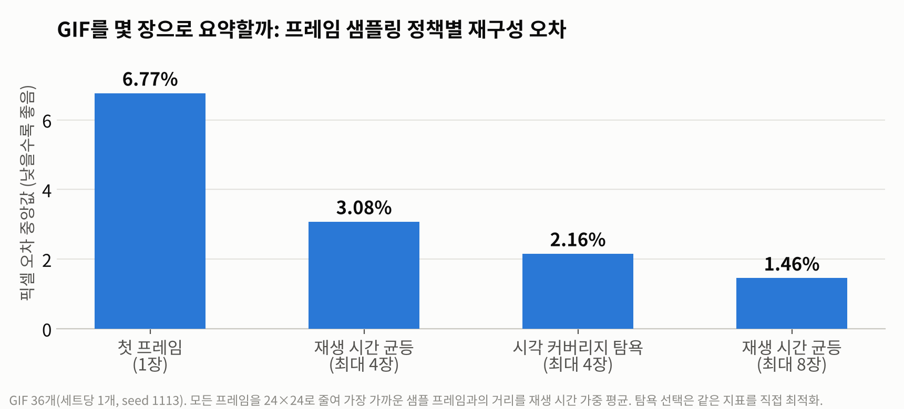
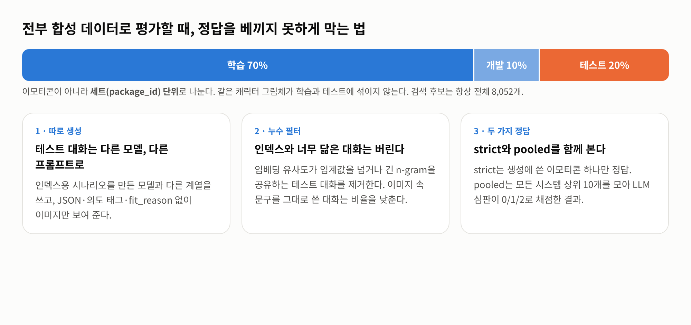
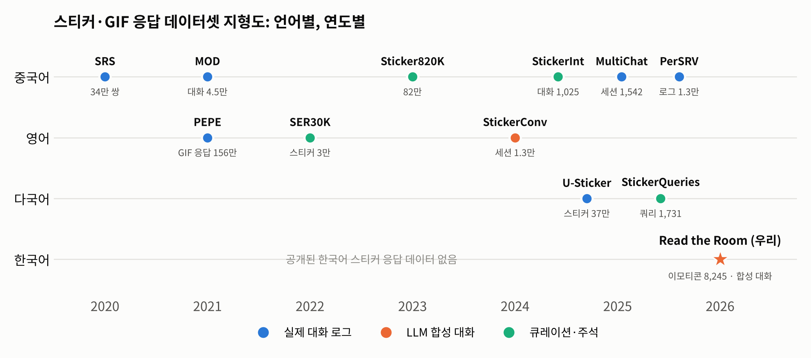

# Read the Room: 대화 맥락을 읽는 개인화 이모티콘 추천

[English](README.md) · **한국어**

**팀원**

- Shin Yunsu, 한양대학교 정보시스템학과, ynsu102@gmail.com
- Yeo Dakyum, 한양대학교 정보시스템학과, yeodakyum@gmail.com

**발표 영상:** 최종 발표(12/9) 전에 여기에 올릴 예정

> ITE351 AI & Applications 중간 블로그입니다. I~III장은 거의 다 썼고, IV장에는 파일럿 실험까지만 들어가 있습니다. 본 실험 결과는 아직 없습니다.

## 목차

- [I. Introduction](#i-introduction)
- [II. Datasets](#ii-datasets)
- [III. Methodology](#iii-methodology)
- [IV. Evaluation & Analysis](#iv-evaluation--analysis)
- [V. Related Work](#v-related-work)
- [VI. Conclusion: Discussion](#vi-conclusion-discussion)
- [참고문헌](#참고문헌)

---

## I. Introduction

### 왜 하게 됐나

시작은 평범한 카톡이었다. 친구가 장학금 받았다고 하면 "미쳤다 ㅋㅋ"에 박수 치는 이모티콘을 보낸다. 그런데 다른 친구가 마감 5분 전에 파일이 날아갔다고 할 때도 똑같이 "미쳤다 ㅋㅋ"라고 친다. 여기에 박수 이모티콘이 붙으면 좀 곤란하다.

메신저의 이모티콘 추천은 이런 걸 잘 못 한다. 우리가 아는 한, 대부분은 방금 친 문장에서 키워드를 뽑거나 문장 유사도를 계산해서 제작자가 달아 둔 태그와 맞춘다. 그러면 앞에서 무슨 얘기를 했는지는 거의 반영이 안 된다. 비꼼, 놀림, 자조 같은 건 더 어렵다. 말과 실제 의도가 반대 방향이기 때문이다. 이미지마다 태그 한두 개로는 실제로 어떻게 쓰이는지도 잘 안 드러난다.

그래서 무엇을 맞출지를 바꿔 보기로 했다. "메시지 텍스트 vs 이미지 태그" 대신,

- 대화는 **지금 어떤 반응이 필요한지**로 바꾸고,
- 이모티콘은 **어떤 상황에서 쓰이는지**로 바꾼다.

둘 다 모델이 쓰게 해서 이미지 수천 개를 손으로 라벨링하지 않아도 되게 하고, 같은 임베딩 공간에서 맞춘다.

### 마지막에 보고 싶은 것

1. 채팅 몇 줄을 넣으면 분위기에 맞는 이모티콘 5개가 나오는 데모. "미쳤다 ㅋㅋ" 예시라면 두 대화에서 다른 결과가 나와야 한다.
2. 키워드 방식보다 낫다는 숫자(Recall@5, MRR). 그리고 앞 턴 하나만 바꿨을 때 순위가 제대로 뒤집히는지 보는 테스트.
3. 재정렬 모델로 한국어 BERT 계열 몇 개를 비교. 댓글로 학습한 모델(실제 채팅 말투에 더 가까움)이 깔끔한 글로 학습한 모델보다 나은지 보고 싶다.
4. 약간의 개인화. 취향이 다른 두 사용자에게 순서가 다르게 나오는 것.

---

## II. Datasets

### 데이터 출처

국내 대형 온라인 커뮤니티의 사용자 제작 이모티콘 마켓에서 수집했다. 크롤러(`crawler/crawl_dccon.py`)가 인기 순위에서 **주간 상위 100세트**를 가져오고, 각 세트에 든 이모티콘을 전부 받는다. 세트는 한 제작자가 만든 이모티콘 묶음이고, 보통 같은 캐릭터에 같은 그림체다.

크롤러가 하는 일은 대략 이렇다.

1. 사이트의 JSON API에서 순위를 받아서, 원본 응답과 받은 시각을 저장한다.
2. 세트마다 상세 데이터를 요청해서 그대로 저장하고, 안에 있는 이모티콘을 하나씩 돈다.
3. 이미지를 원본 바이트 그대로 받는다. 확장자는 믿지 않고 Pillow로 열어서 실제 형식을 확인한다. 크기, 투명도, 프레임 수, 프레임별 재생 시간, SHA-256도 같이 기록한다.

요청 사이에 0.35초씩 쉬고, 중간에 멈춰도 이어서 받을 수 있다. 스냅샷은 Cloudflare R2에 올려서 누구나 받을 수 있게 했다([PUBLIC_DATASET_ACCESS.md](docs/PUBLIC_DATASET_ACCESS.md) 참고).

<!-- 샘플 이미지: docs/blog/ko/samples.png (이미지 확보 후 추가) -->

| | 개수 |
|---|---|
| 세트 | 100 |
| 이모티콘 행 | 8,245 |
| 이미지 확보 | 8,218 (실패 27) |
| 고유 이미지 (SHA-256 기준) | 8,052 |
| 애니메이션 GIF | 3,060 (37.2%) |
| 제목이 숫자뿐인 것 | 4,891 (59.5%) |

순위 스냅샷은 2026년 11월 12일 기준이다.

데이터를 열어 보고 놀란 게 두 가지 있었다.

- **제목이 거의 쓸모없다.** 60% 정도가 그냥 "1", "2", "3" 같은 이름이다. 제목이나 태그로 검색하는 방식은 카탈로그의 절반 이상을 아예 못 본다는 뜻이다. 사실상 이게 방향을 정했다.
- **GIF가 많다.** 37% 정도가 움직이고, 글자가 애니메이션 중간에야 나오는 경우도 있다.

### 형식

| 파일 | 내용 |
|---|---|
| `packages.jsonl` | 세트당 한 줄 (순위, 제목, 설명, 제작자, 태그, 가격 등) |
| `stickers.jsonl` | 이모티콘당 한 줄 (세트 ID, 이모티콘 ID, 이미지 경로, 형식, 크기, 프레임 정보, SHA-256) |
| `images/<package_id>/` | 원본 이미지 |
| `raw/packages/*.json` | API 원본 응답 |
| `errors.jsonl`, `summary.json` | 실패 기록, 수집 완료 여부 |

형식을 아무렇게나 정하지 않으려고 다른 데이터셋들이 어떻게 했는지 먼저 봤다.

- 이미지 하나에 JSON 한 줄 + 이미지 폴더 구조는 Hugging Face [ImageFolder](https://huggingface.co/docs/hub/datasets-image)(`metadata.jsonl`)와 같다. 나중에 Hub에 올리기 편하다.
- 세트 ID와 이모티콘 ID를 따로 두는 건 스티커 응답 데이터셋의 시초인 [SRS](https://github.com/gsh199449/stickerchat)가 쓴 방식이다(`sticker_set_id`, `sticker_id`).
- 학습/테스트는 **이모티콘이 아니라 세트 단위로** 나눈다. 같은 세트는 그림체가 같아서, 양쪽에 섞이면 모델이 그림체를 외워 버릴 수 있다.
- SHA-256으로 완전히 같은 이미지는 하나로 친다. 실제로 세트끼리 겹치는 이미지가 있었다(8,218개 중 고유 8,052개). [PEPE](https://github.com/xingyaoww/gif-reply)도 해시로 같은 GIF를 묶었다.

### 합성 주석 (파일럿)

이미지만으로는 텍스트 모델이 쓸 수 없고 제목도 대부분 비어 있어서, 비전-언어 모델(VLM)이 이미지를 직접 보고 이런 걸 적게 했다.

1. 보이는 것 (누가 뭘 하는지, 눈, 입, 홍조, 눈물...)
2. 시각 태그 5개 정도, 최대한 구체적으로 ("얼굴" 말고 "반쯤 감긴 눈")
3. 이미지 속 글자, 오타랑 밈 표기까지 그대로
4. 맥락에 따라 진심으로도 비꼼으로도 읽힐 수 있으면 메모
5. **이 이모티콘이 자연스러운 대화 5개**: 상황, A/B 대화 몇 턴, 이모티콘과 같이 보내는 마지막 메시지, 의도 태그, 왜 맞는지 한 문장

위 예시는 우리가 좋아하는 것 중 하나다. "굉장한 놈이잖아요!~최고잖아요!"라고 외치는 이모티콘인데, 다섯 대화 중 넷에서는 진짜 칭찬이다. 나머지 하나에서는 멀쩡한 이어폰을 물통 색이랑 안 맞는다고 새로 산 친구한테 보내는 농담이 된다. "칭찬" 태그 하나로는 이걸 못 잡는다.

시각 태그와 의도 태그는 일부러 나눴다. "눈물"은 눈에 보이는 거고, "자조"는 그 대화에서 그 눈물이 뜻하는 거다.

지금까지 **91개 세트의 이모티콘 378개에 돌려서 대화 1,890개**를 얻었다.

- 45%가 이미지 안에 글자가 있다. 글자를 읽는 게 정말 중요하다.
- 자조(49), 친근한 놀림(32), 반어(18) 같은 태그가 꾸준히 나왔다. 우리가 잡고 싶던 반응이라 반가웠다.
- 아쉬운 점: 의도 태그를 자유롭게 쓰게 했더니 **867종**이나 나왔다. 정해진 체계로 묶어야 하고, 아마 [KOTE](https://github.com/searle-j/KOTE)의 43개 감정을 쓸 것 같다.
- 대화를 2~5턴으로 쓰라고 했는데 거의 다 2~3턴이었다. 본 생성 때는 필터가 필요하다.

학습 데이터와 테스트 데이터 모두 이렇게 생성할 거고, 사람이 쓴 대화는 쓰지 않을 계획이다.

---

## III. Methodology

시스템은 이모티콘을 미리 준비하는 오프라인 부분과, 채팅할 때 돌아가는 온라인 부분으로 나뉜다.

### 오프라인: 이모티콘을 "어떻게 쓰이는지"로 설명하기

이모티콘마다 위의 JSON 설명과 사용 대화 5~10개를 만든다. VLM은 Qwen2.5-VL 같은 오픈 모델을 쓸 생각인데 아직 확정은 아니다. 이미지 속 한국어를 얼마나 잘 읽는지 보고 바꿀 수도 있다.

사람이 일일이 확인하지 않으니까 필터를 자동으로 건다.

- **형식 검사**: JSON이 맞는지, 턴 수가 범위 안인지, 메시지에 "(스티커 전송)" 같은 설명이 끼어 있지 않은지
- **중복 제거**: 같은 이모티콘의 대화끼리 임베딩이 너무 비슷하면 하나만 남김
- **근거 검사**: 다른 LLM이 "왜 맞는지" 문장이 대화와 이미지 양쪽에 실제로 있는 걸 가리키는지 확인

통과한 대화는 **Qwen3-Embedding-0.6B**로 임베딩해서 **FAISS** 인덱스에 넣는다.

### 온라인: 이 대화에는 어떤 반응이 필요할까

1. **반응 추출.** 최근 6개 정도의 메시지를 LLM에 주고, 다음 답장에 어떤 감정, 의도, 톤이 필요한지 묻는다. 장학금 대화면 "축하, 들뜸, 장난스러움", 파일 날아간 대화면 "공감, 놀람, 위로" 정도가 나와야 한다.
2. **검색.** 그 설명으로 인덱스를 검색해서 상위 50개를 뽑는다. 이모티콘마다 대화가 여러 개 있으니, 그중 가장 잘 맞는 대화의 점수를 그 이모티콘 점수로 쓴다. 쓰임새가 제각각인 이모티콘도 그중 하나만 맞으면 걸리게 하려는 것이다.
3. **재정렬.** cross-encoder가 대화와 이모티콘 설명을 같이 읽고 50개 점수를 다시 매긴다. 진심이냐 비꼼이냐를 가르려면 양쪽을 같이 읽어야 할 거라고 생각했다. 일반 임베딩 검색은 그걸 안 한다.
4. **개인화** 후 최종 5개.

### BERT 모델 비교

모델 비교는 재정렬 단계에서 한다. 학습 방식은 똑같이 하고 백본만 바꾼다.

| 종류 | 모델 | 고른 이유 |
|---|---|---|
| 댓글체 한국어 | `beomi/kcbert-base`, `beomi/KcELECTRA-base` | 뉴스 댓글로 학습해서 "ㅋㅋ", 이모지, 은어에 익숙함 |
| 표준 한국어 | `klue/roberta-large`, `monologg/koelectra-base-v3` | 모두의 말뭉치, 위키, 뉴스 같은 정제된 글로 학습 |
| 다국어 | `FacebookAI/xlm-roberta-large` | 기준선 |
| 신형 인코더 | `skt/A.X-Encoder-base` | ModernBERT 기반 한국어 인코더 |

검색 단계 임베딩 모델도 몇 개 돌려 볼 거다. Qwen3-Embedding-0.6B, KURE-v1, BGE-M3. KURE 저자들이 공개한 한국어 검색 벤치마크에서는 KURE-v1 0.7616, BGE-M3 0.7509, Qwen3-Embedding-0.6B 0.7140이었다. 다국어 벤치마크랑 순서가 달라서 우리 데이터로 직접 확인해 보려고 한다. 어차피 그 벤치마크는 문서 검색이지 채팅이 아니기도 하다.

### 개인화

사용자가 좋아요/숨김한 세트, 선호하는 톤, 최근에 고른 것들을 피처로 만들어 **LightGBM** 랭커(LambdaRank)에 넣는다. 데이터가 쌓이기 전에는 우리가 정한 가중치로 합만 한다. 솔직히 이번 학기에는 실제 사용 로그가 없어서, 취향을 정해 둔 가상 사용자로 테스트할 예정이다. 이건 랭커가 피처를 제대로 쓰는지만 보여 주고, 실제 사람이 결과를 좋아하는지는 보여 주지 못한다.

### 코드와 라이브러리

- `crawler/crawl_dccon.py`: 크롤러 (Python 표준 라이브러리 + Pillow, truststore)
- `crawler/upload_r2.py`: Cloudflare R2 업로드 (boto3, python-dotenv)
- `experiments/pilot1/metadata_probe.py`: IV장의 제목 검색 실험
- `experiments/pilot1/gif_coverage.py`: IV장의 GIF 프레임 실험
- 사용 예정: Hugging Face Transformers, sentence-transformers, FAISS, LightGBM

---

## IV. Evaluation & Analysis

본 실험은 아직이다. 이 장에는 설계를 정하려고 돌린 작은 실험 세 개와 평가 계획을 적었다.

### 1. 제목으로 검색하면 안 될까? 안 된다.

`experiments/pilot1/metadata_probe.py`. 고유 이미지 8,052개의 제목과 태그를 한국어 2~3글자 n-gram으로 검색했다. 쿼리는 마지막 메시지는 같고 바로 앞 턴만 다른 대화 네 쌍을 직접 썼다.

| 앞 턴 | 마지막 메시지 | 필요한 반응 |
|---|---|---|
| 나 장학금 받았어! | 미쳤다 ㅋㅋ | 축하 |
| 마감 5분 전에 파일 날아갔어. | 미쳤다 ㅋㅋ | 위로 |
| 아까 내 말 때문에 상처받았어. | 와 진짜? | 사과 |
| 네가 갖고 싶다던 거 내가 사 왔어. | 와 진짜? | 감사 |

한 쌍은 두 대화가 똑같은 결과 세 개를 냈다. 앞 턴이 아무 영향을 못 준 거다. 의도를 직접 넣어 봤을 때도 "축하"는 몇 개 걸렸는데 "위로"는 하나도 안 걸렸다.

결과를 사람이 채점하지 않았으니 제대로 된 벤치마크는 아니다. 그래도 제목 검색으로는 안 된다는 확신을 얻기엔 충분했다.

### 2. GIF는 프레임을 몇 장 봐야 할까

`experiments/pilot1/gif_coverage.py`. GIF 36개(세트당 하나, seed 1113)로, 프레임을 어떻게 고르면 전체 애니메이션을 잘 대표하는지 쟀다. 모든 프레임을 24×24로 줄이고, 각 프레임이 우리가 고른 프레임 중 가장 가까운 것과 얼마나 다른지를 재생 시간으로 가중 평균했다.

재생 시간 기준으로 4장을 고르게 뽑으면 오차가 6.77%(첫 프레임만)에서 3.08%로 줄었다. 8장이면 1.46%까지 내려가지만 VLM 비용이 두 배다.

시간을 꽤 썼는데, 결국 **GIF 처리는 프로젝트의 메인으로 가져가지 않기로 했다.** 이 지표는 애니메이션을 얼마나 "덮었는지"만 말해 주고 추천이 좋아지는지는 보여 주지 않는다. 그걸 증명하려면 연구가 하나 더 필요하다. 지금은 GIF를 프레임 하나로 표현하고, 한계로 적어 두려고 한다.

### 3. OCR은 이 글자들을 못 읽는다

눈으로 확인한 한국어 문구 6개에 기성 OCR을 돌려 봤는데 6개 중 0개를 맞혔다. 밈 폰트랑 이상한 맞춤법 때문인 것 같다. 그래서 OCR을 따로 쓰지 않고 VLM이 글자를 읽게 했다.

### 평가 계획

테스트 데이터도 합성이라 문제가 하나 있다. 인덱스 대화랑 테스트 대화를 비슷한 모델이 쓰면, 시스템이 그냥 인덱스에서 테스트 대화의 복사본을 찾아낼 수도 있다. 세 가지로 막아 보려고 한다.

1. **세트 단위**로 70/10/20(학습/개발/테스트) 분할. 테스트 세트는 학습에 안 쓰지만, 검색은 여전히 8,052개 전체에서 한다.
2. 테스트 대화는 **다른 모델, 다른 프롬프트**로 쓴다. 그 모델은 이미지만 보고 JSON이나 태그는 안 본다.
3. 인덱스와 너무 비슷한 테스트 대화는 버리고, 이미지 속 문구를 그대로 베낀 대화는 줄인다.

정답은 일단 "그 대화를 만들 때 쓴 이모티콘"이다(*strict*). 근데 후보가 8천 개면 좋은 답이 여러 개인 경우가 많아서 *pooled* 정답도 만든다. 모든 시스템의 상위 10개를 모아 LLM 심판이 0/1/2점을 주고, 2점도 정답으로 친다.

지표는 **Recall@5**와 **MRR**이다. **대조쌍** 테스트도 한다. 마지막 메시지는 같고 앞 턴만 다른 두 대화에서, 각 대화의 이모티콘이 상대 것보다 위에 와야 통과다. 동점은 실패로 친다. (Gardner et al.의 Contrast Sets 아이디어)

비교 대상:

- **B1 키워드**: 마지막 메시지로 제목, 세트 제목, 태그를 BM25 검색. 지금 메신저 방식에 가깝다.
- **B2 문장 유사도**: 마지막 메시지와 VLM 설명의 임베딩 유사도
- **우리 방식**, 그리고 단계를 하나씩 빼 보는 ablation

| 시스템 | Recall@5 | MRR | 대조쌍 정확도 |
|---|---|---|---|
| B1 키워드 | – | – | – |
| B2 문장 유사도 | – | – | – |
| 우리 (재정렬 없음) | – | – | – |
| 우리 + KcELECTRA | – | – | – |
| 우리 + KLUE-RoBERTa | – | – | – |
| 우리 + XLM-R | – | – | – |

*(채울 예정)*

미리 말해 두면, 전부 생성 데이터라서 이 숫자는 실제 사용자 행동이 아니라 "생성 모델이 좋다고 생각하는 답장"과 얼마나 맞는지를 잰다. 심판 점수랑 테스트 대화 일부는 우리가 직접 읽어 보면서 확인할 생각이다.

---

## V. Related Work

시작하기 전에 비슷한 게 있는지 Hugging Face Hub, GitHub, 국내 논문 DB를 찾아봤다.

스티커 응답 연구는 2020년쯤부터 있었는데, **찾은 건 전부 중국어 아니면 영어였다.** 한국어 커뮤니티 이모티콘을 답장으로 다룬 공개 데이터셋은 못 찾았다. GitHub에는 다운로더 스크립트 정도만 있었다.

| 연구 | 발표 | 언어 | 규모 | 한 것 |
|---|---|---|---|---|
| [SRS](https://github.com/gsh199449/stickerchat) | WWW 2020 | 중국어 | 대화-스티커 쌍 약 34만 | "다음 스티커 고르기" 과제를 처음 제안 |
| PESRS | TOIS 2021 | 중국어 | SRS 확장 | 사용자의 과거 선택 반영 |
| [MOD](https://arxiv.org/abs/2109.01839) | 2021 | 중국어 | 대화 45,174 | 밈이 섞인 대화, 밈 감정 |
| [PEPE](https://github.com/xingyaoww/gif-reply) | EMNLP Findings 2021 | 영어 | 트윗-GIF 답장 약 156만 | GIF 답장, GIF당 4프레임, OCR + 태그 |
| SER30K | ACM MM 2022 | 영어 | 스티커 30,739 | 스티커 감정 분류 |
| [StickerConv](https://arxiv.org/abs/2402.01679) | ACL 2024 | 영어 | 세션 12,931 | LLM 에이전트로 스티커 대화 생성 |
| StickerInt | TASLP 2025 | 중국어 | 대화 1,025 | 스티커가 말하려는 의도 모델링 |
| MultiChat | AAAI 2025 | 중국어 | 세션 1,542 | 여러 세션의 그룹 채팅 |
| [PerSRV](https://arxiv.org/abs/2410.21801) | WWW 2025 | 중국어 | 로그 12,568 | VLM이 스티커 설명을 쓰고 텍스트로 검색 |
| [U-Sticker](https://huggingface.co/datasets/metchee/u-sticker) | SIGIR 2025 | 다국어 | 스티커 약 37만 | 사용자 로그로 개인화 검색 |
| [StickerQueries](https://huggingface.co/datasets/metchee/sticker-queries) | ACM MM 2025 | 영·중 | 쿼리 1,731 | 게임으로 모은 검색어 |

우리랑 제일 가까운 건 이 셋이다.

- **PerSRV**가 우리 접근이랑 제일 비슷하다. VLM으로 스티커를 설명하게 하고 텍스트로 검색하고, OCR 글자를 많이 쓴다. 우리가 이미지 속 글자에 신경 쓴 이유 중 하나다.
- **StickerConv**도 LLM으로 스티커 대화를 만들지만 목적이 다르다. 거기는 챗봇 학습용으로 긴 세션을 만들고, 우리는 검색 키로 쓸 짧은 답장 대화를 만든다.
- **PEPE**는 GIF 답장을 다루고 4프레임을 뽑는다. 우리 GIF 실험이 여기서 시작됐다.

CLIP 같은 범용 이미지 모델이 스티커의 미묘한 뜻을 잘 못 잡는다는 내용도 읽었다. 이미지를 바로 임베딩하지 않고 텍스트를 거치는 이유가 하나 더 생긴 셈이다.

한국어 쪽:

- [KOTE](https://github.com/searle-j/KOTE): 온라인 댓글 5만 개에 43개 감정을 붙인 데이터. "어이없음", "패배/자기혐오" 같은 레이블이 커뮤니티 이모티콘이랑 잘 맞아서 의도 태그 정리에 쓸 예정이다.
- [KoCoSa](https://huggingface.co/datasets/YuminKim/KoCoSa): 한국어 대화 12,824개에 비꼼 레이블을 단 데이터. 비꼼을 알아채려면 맥락이 필요하다는 게 핵심 결론인데, 사실상 우리 동기랑 같은 얘기다.
- 카카오톡 이모티콘을 감성 스타일로 추천한 2018년 논문도 있었지만 대화는 안 본다.

### 사용한 도구, 라이브러리, 문서

- Hugging Face [이미지 데이터셋 문서](https://huggingface.co/docs/hub/datasets-image): 데이터 형식 참고
- Cloudflare R2 문서([public buckets](https://developers.cloudflare.com/r2/buckets/public-buckets/), [boto3](https://developers.cloudflare.com/r2/examples/aws/boto3/)): 데이터셋 호스팅
- Pillow(이미지, GIF 프레임 읽기), boto3, python-dotenv, truststore
- 사용 예정 모델: Qwen2.5-VL(또는 비슷한 VLM), [Qwen3-Embedding-0.6B](https://huggingface.co/Qwen/Qwen3-Embedding-0.6B), [KURE-v1](https://huggingface.co/nlpai-lab/KURE-v1), [KcBERT](https://huggingface.co/beomi/kcbert-base), KLUE-RoBERTa, XLM-R
- 사용 예정 라이브러리: Transformers, sentence-transformers, FAISS, LightGBM
- 선행연구 조사와 블로그 초안 일부에 Claude를 활용함

---

## VI. Conclusion: Discussion

지금까지 한 것: 이모티콘 8,245개를 수집해서 공개했고, 378개로 주석 형식을 테스트했고, 시스템 전체 설계를 잡았다. 파일럿 실험들은 주로 *하면 안 되는 것*을 알려 줬다. 제목 검색은 이 데이터에서 안 되고, 우리가 써 본 OCR은 이 글자들을 못 읽고, GIF 프레임 고르기는 재밌지만 곁가지로 하기엔 너무 크다.

아직 확신이 없는 것들:

- LLM이 쓴 테스트셋이 공정할까? 눈에 띄는 누수는 막으려고 했지만 시스템이랑 테스트가 결국 비슷한 모델에서 나온다. 어떻게 되든 일부는 손으로 볼 것 같다.
- 의도 태그 867종은 예상보다 훨씬 많았다. KOTE로 묶으면 "친근한 놀림"과 그냥 "놀림" 같은 미묘한 차이가 사라질 수도 있다.
- 개인화가 제일 약하다. 실제 사용자가 없어서다. 시간이 모자라면 범위를 줄일 수도 있다.

다음 할 일: 전체 카탈로그에 생성 돌리기, 테스트셋과 대조쌍 만들기, 발표 전에 B1, B2, 우리 방식의 첫 숫자 뽑기.

### 저작권 관련

이모티콘의 권리는 각 제작자에게 있다. 이 데이터는 비상업 연구용으로만 쓴다. 사이트 이용약관이 영리 이용과 재배포를 제한하고 있어서, 내려야 할 이미지가 있으면 이슈로 알려 주면 바로 지우겠다.

---

## 참고문헌

- S. Gao et al., "Learning to Respond with Stickers: A Framework of Unifying Multi-Modality in Multi-Turn Dialog," WWW 2020.
- S. Gao et al., "Learning to Respond with Your Favorite Stickers," ACM TOIS, 2021.
- Z. Fei et al., "Towards Expressive Communication with Internet Memes," arXiv:2109.01839, 2021.
- X. Wang and D. Jurgens, "An Animated Picture Says at Least a Thousand Words: Selecting Gif-based Replies in Multimodal Dialog," Findings of EMNLP 2021.
- S. Liu, X. Zhang and J. Yang, "SER30K: A Large-Scale Dataset for Sticker Emotion Recognition," ACM MM 2022.
- Y. Zhang et al., "STICKERCONV: Generating Multimodal Empathetic Responses from Scratch," ACL 2024.
- B. Liang et al., "Reply with Sticker: New Dataset and Model for Sticker Retrieval," IEEE/ACM TASLP, 2025.
- B. Wang et al., "A New Formula for Sticker Retrieval: Reply with Stickers in Multi-Modal and Multi-Session Conversation," AAAI 2025.
- H. E. M. Chee et al., "PerSRV: Personalized Sticker Retrieval with Vision-Language Model," WWW 2025.
- H. E. M. Chee et al., U-Sticker (SIGIR 2025), StickerQueries (ACM MM 2025).
- M. Gardner et al., "Evaluating Models' Local Decision Boundaries via Contrast Sets," Findings of EMNLP 2020.
- D. Jeon, J. Lee and C. Kim, "User Guide for KOTE: Korean Online That-gul Emotions Dataset," LREC-COLING 2024.
- Y. Kim et al., "KoCoSa: Korean Context-aware Sarcasm Detection Dataset," LREC-COLING 2024.
- J. Lee, "KcBERT: Korean Comments BERT," 2020.
- S. Park et al., "KLUE: Korean Language Understanding Evaluation," NeurIPS Datasets and Benchmarks, 2021.
- Y. Zhang et al., "Qwen3 Embedding," arXiv:2506.05176, 2025.
