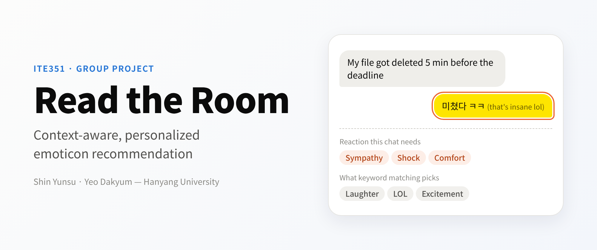
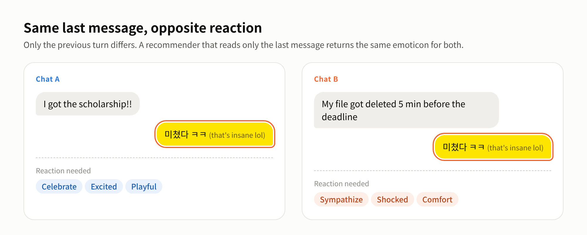
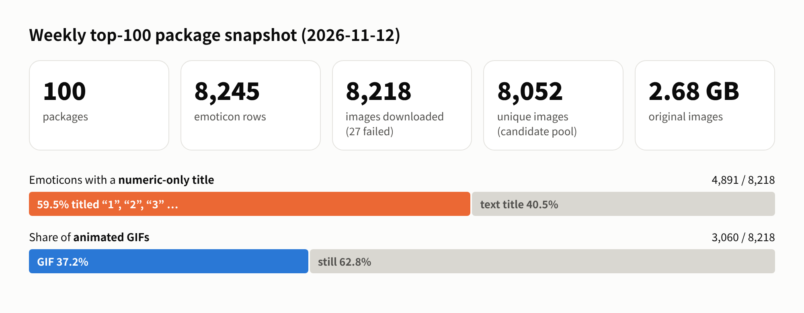
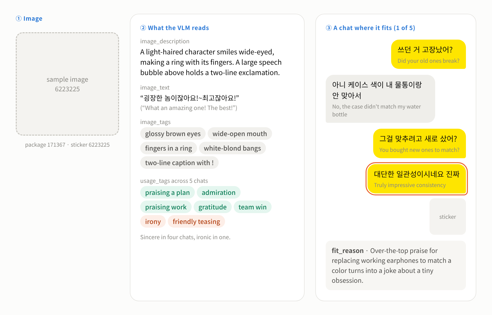
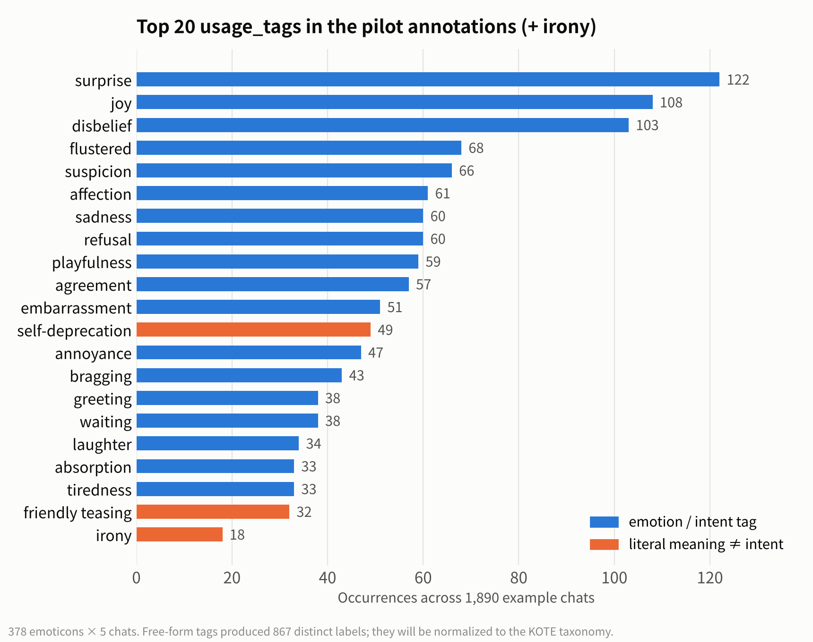
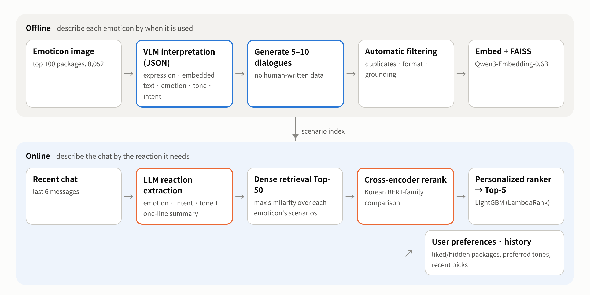
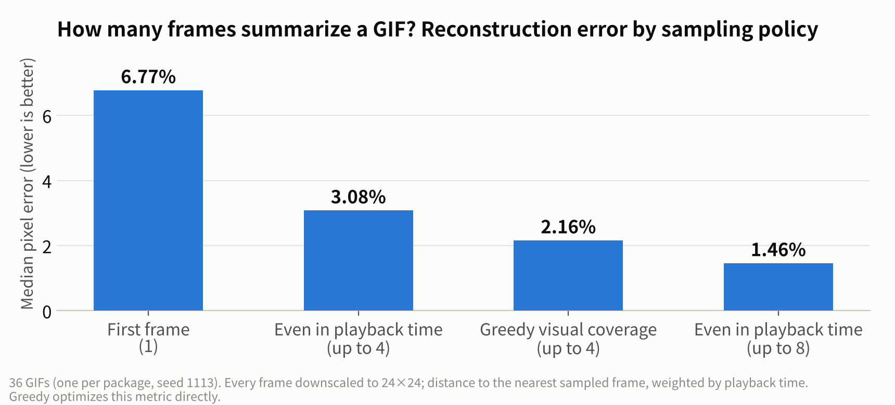
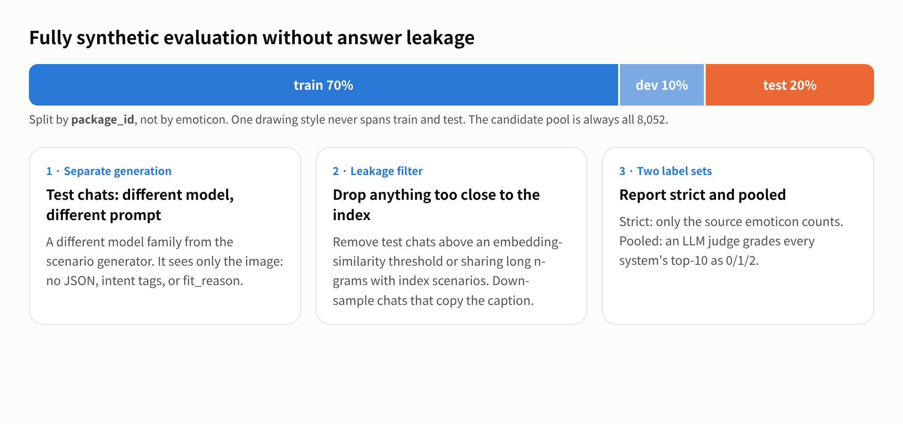
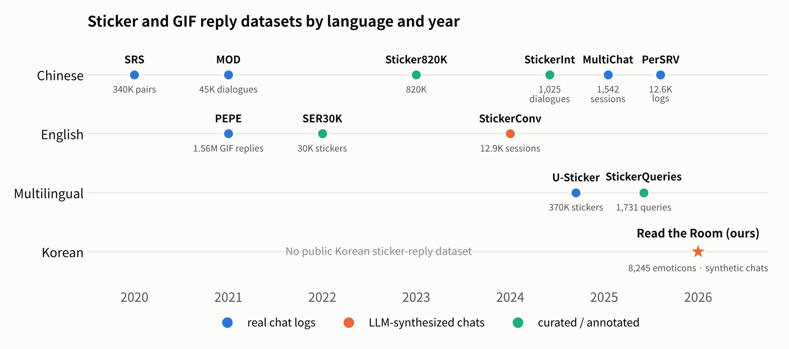

# Read the Room: Context-Aware and Personalized Emoticon Recommendation from Chat History

**English** · [한국어](README.ko.md)

**Members**

- Shin Yunsu, Department of Information Systems, Hanyang University, ynsu102@gmail.com
- Yeo Dakyum, Department of Information Systems, Hanyang University, yeodakyum@gmail.com

**Video:** will be added here before the final presentation (Dec. 9)

> This is our blog in progress for ITE351 AI & Applications. Sections I to III are mostly written. Section IV has our pilot experiments, but the main results aren't in yet.

## Table of Contents

- [I. Introduction](#i-introduction)
- [II. Datasets](#ii-datasets)
- [III. Methodology](#iii-methodology)
- [IV. Evaluation & Analysis](#iv-evaluation--analysis)
- [V. Related Work](#v-related-work)
- [VI. Conclusion: Discussion](#vi-conclusion-discussion)
- [References](#references)

---

## I. Introduction

### Motivation

This started with a pretty ordinary chat. One friend says they got a scholarship, and you reply "미쳤다 ㅋㅋ" (roughly "that's insane lol") with a clapping emoticon. Another friend says their file got deleted five minutes before a deadline, and you type the exact same "미쳤다 ㅋㅋ". If you attach the same clapping emoticon there, that's a problem.

The emoticon suggestions in messenger apps don't really handle this. As far as we can tell, most of them take the sentence you just typed and match keywords (or sentence similarity) against tags that the creator attached to each image. So the earlier part of the conversation is basically ignored. Sarcasm, teasing and self-deprecating jokes are even harder, because the words and the actual intent go in different directions. And one or two tags per image don't say much about how people actually use an emoticon.

Our idea is to change what gets matched. Instead of "message text vs. image tags":

- the conversation becomes **what kind of reaction is needed right now**, and
- each emoticon becomes **the situations where it would be used**.

Both of these are written by models, so we don't have to hand-label thousands of images, and then we match them in the same embedding space.

### What we want to see at the end

1. A small demo where you paste a few chat messages and get 5 emoticons that actually fit the mood. For the "미쳤다 ㅋㅋ" example, the two chats should get different results.
2. Numbers showing this beats the keyword approach (Recall@5, MRR), and a test where we only change one earlier turn and check if the ranking flips the right way.
3. A comparison of a few Korean BERT-style models as the reranker, to see whether a model trained on comments (closer to how people actually chat) does better than ones trained on cleaner text.
4. Some personalization, so that two users with different taste get a different order.

---

## II. Datasets

### Where the data comes from

We collect emoticons from the user-made emoticon market of a big Korean online community. Our crawler (`crawler/crawl_dccon.py`) takes the **weekly top 100 packages** from the popularity ranking and downloads every emoticon in each package. A package is a set of emoticons from one creator, usually with the same character and drawing style.

What the crawler does, roughly:

1. Gets the ranking from the site's JSON API and saves the raw response with the time it was fetched.
2. For each package, requests the detail page data, saves it as is, and goes through every emoticon listed there.
3. Downloads each image as the original bytes. We don't trust the file extension. We open the file with Pillow to find the real format, and we record the size, transparency, number of frames, how long each frame plays, and a SHA-256 hash.

It waits 0.35 s between requests and can resume if it stops halfway. We uploaded the snapshot to Cloudflare R2 so anyone can download it (see [PUBLIC_DATASET_ACCESS.md](docs/PUBLIC_DATASET_ACCESS.md)).

<!-- Samples: docs/blog/en/samples.png (add once images are available) -->

| | Count |
|---|---|
| Packages | 100 |
| Emoticon rows | 8,245 |
| Images downloaded | 8,218 (27 failed) |
| Unique images (by SHA-256) | 8,052 |
| Animated GIFs | 3,060 (37.2%) |
| Titles that are only a number | 4,891 (59.5%) |

The ranking snapshot is from Nov. 12, 2026.

Two things surprised us once we looked at the data:

- **Most titles are useless.** About 60% of the emoticons are just called "1", "2", "3" and so on. So any approach that searches by title or tag can't even see more than half of the catalog. This pretty much decided our direction.
- **A lot of them are GIFs.** Around 37% move, and sometimes the text only shows up in the middle of the animation.

### Format

| File | What's in it |
|---|---|
| `packages.jsonl` | one row per package (rank, title, description, creator, tags, price, ...) |
| `stickers.jsonl` | one row per emoticon (package id, emoticon id, image path, format, size, frame info, SHA-256) |
| `images/<package_id>/` | the original image files |
| `raw/packages/*.json` | raw API responses |
| `errors.jsonl`, `summary.json` | what failed, and whether the crawl finished |

We tried not to pick the format randomly, so we looked at what other datasets did first:

- One JSON line per image plus an image folder is the same layout as Hugging Face's [ImageFolder](https://huggingface.co/docs/hub/datasets-image) (`metadata.jsonl`). That makes uploading to the Hub easy later.
- Keeping a package id and an emoticon id separately is how [SRS](https://github.com/gsh199449/stickerchat), the first sticker-reply dataset, did it (`sticker_set_id`, `sticker_id`).
- When we split into train/test, we split **by package, not by emoticon**. Emoticons in the same package share a style, and if they end up in both train and test, a model can just memorize the style.
- We remove exact duplicates with SHA-256. There really were duplicates across packages (8,218 images, but only 8,052 unique). [PEPE](https://github.com/xingyaoww/gif-reply) also grouped identical GIFs by hash.

### Synthetic annotations (pilot)

The images alone aren't enough for a text model, and the titles are mostly empty, so we have a vision-language model (VLM) look at each image and write down:

1. what it sees (who is doing what, eyes, mouth, blush, tears...)
2. about 5 visual tags, as specific as possible ("half-closed eyes" instead of "face")
3. the text inside the image, copied exactly, typos and meme spelling included
4. a note if the image could be read as sincere or sarcastic depending on context
5. **5 short chats where this emoticon would be a natural reply**: a situation, a few turns between A and B, the last message sent with the emoticon, intent tags, and one sentence on why it fits

The example above is one of our favorites. The emoticon is basically screaming "What an amazing one! The best!". In four of its five chats it's a real compliment. In the fifth, a friend replaced perfectly fine earphones because the case didn't match their water bottle, and the same emoticon becomes a joke. A tag like "praise" wouldn't catch that.

We keep visual tags and intent tags separate on purpose. "Tears" is something you can see. "Self-deprecation" is what the tears mean in that specific chat.

So far we've run this on **378 emoticons from 91 packages, which gave 1,890 chats.**

- 45% of the emoticons have text in the image, so reading that text matters a lot.
- Tags like self-deprecation (49), friendly teasing (32) and irony (18) show up regularly. That's the kind of reaction we wanted to capture, so this was good to see.
- The bad part: we let the model write intent tags freely, and it came up with **867 different tags**. We'll have to map them to a fixed set, probably the 43 emotions from [KOTE](https://github.com/searle-j/KOTE).
- We asked for 2 to 5 turns per chat, but it almost always wrote 2 or 3. We'll need a filter for that in the real run.

All of our training and test data will be generated like this. We don't plan to use any human-written chats.

---

## III. Methodology

The system has an offline part, which prepares the emoticons, and an online part, which runs when someone is chatting.

### Offline: describing emoticons by how they're used

For every emoticon we generate the JSON description above plus 5 to 10 usage chats. For the VLM we're planning to use an open model like Qwen2.5-VL, but we haven't fully decided. We might switch depending on how well it reads Korean text in images.

Since no human checks every sample, we filter automatically:

- **format check**: valid JSON, number of turns in range, no "(sends sticker)" style notes inside the message
- **near-duplicates**: if two chats for the same emoticon have very similar embeddings, keep only one
- **grounding check**: a second LLM checks whether the "why it fits" sentence actually points to something in both the chat and the image

The chats that survive get embedded with **Qwen3-Embedding-0.6B** and stored in a **FAISS** index.

### Online: what reaction does this chat need?

1. **Reaction extraction.** We give the last ~6 messages to an LLM and ask what emotion, intent and tone the next reply should have. For the scholarship chat we'd expect something like "celebrate, excited, playful". For the deleted-file chat, "sympathize, shocked, comfort".
2. **Retrieval.** We search the index with that description and take the top 50 emoticons. Each emoticon has several chats in the index, and we use its best-matching one as its score. That way an emoticon that's used in very different situations can still be found from any of them.
3. **Reranking.** A cross-encoder reads the chat and the emoticon description together and re-scores the 50. Our guess is that telling sincere from sarcastic needs both sides read together, which a plain embedding search doesn't do.
4. **Personalization**, then the final top 5.

### Comparing BERT models

The reranker is where we compare models. We fine-tune each one the same way and only swap the backbone:

| Type | Model | Why we picked it |
|---|---|---|
| comment-style Korean | `beomi/kcbert-base`, `beomi/KcELECTRA-base` | trained on news comments, so it's used to "ㅋㅋ", emoji and slang |
| standard Korean | `klue/roberta-large`, `monologg/koelectra-base-v3` | trained on cleaner text (Modu corpus, wiki, news) |
| multilingual | `FacebookAI/xlm-roberta-large` | baseline |
| newer encoder | `skt/A.X-Encoder-base` | Korean encoder based on ModernBERT |

We'll also try a few embedding models for the retrieval step: Qwen3-Embedding-0.6B, KURE-v1 and BGE-M3. On the Korean retrieval benchmark the KURE authors published, KURE-v1 scored 0.7616, BGE-M3 0.7509 and Qwen3-Embedding-0.6B 0.7140. That's a different order from the multilingual benchmarks, which is why we want to check all three on our own data. Those benchmarks are about document search anyway, not chats.

### Personalization

Each user's liked or hidden packages, preferred tones and recent picks become features for a **LightGBM** ranker (LambdaRank). Until there's enough data we'll just use a weighted sum with weights we set by hand. To be honest, we won't have real user logs this semester, so we'll test it with simulated users who have fixed preferences. That only shows the ranker uses the features correctly, not that real people like the results.

### Code and libraries

- `crawler/crawl_dccon.py`: crawler (Python standard library + Pillow, truststore)
- `crawler/upload_r2.py`: uploads the snapshot to Cloudflare R2 (boto3, python-dotenv)
- `experiments/pilot1/metadata_probe.py`: the title-search experiment in Section IV
- `experiments/pilot1/gif_coverage.py`: the GIF frame experiment in Section IV
- planned: Hugging Face Transformers, sentence-transformers, FAISS, LightGBM

---

## IV. Evaluation & Analysis

The main experiments aren't done yet. This section has the three small experiments we ran to decide the design, plus how we plan to evaluate.

### 1. Can we just search by title? No.

`experiments/pilot1/metadata_probe.py`. We searched the titles and tags of all 8,052 unique images using Korean 2- and 3-character n-grams. As queries we wrote four pairs of chats where the last message is identical and only the turn before it changes:

| Previous turn | Last message | Reaction needed |
|---|---|---|
| I got the scholarship! | 미쳤다 ㅋㅋ | celebrate |
| My file got deleted 5 minutes before the deadline. | 미쳤다 ㅋㅋ | comfort |
| What you said earlier hurt me. | 와 진짜? ("wait, really?") | apologize |
| I bought you the thing you wanted. | 와 진짜? | thank |

For one pair, both chats returned the exact same three results, so the earlier turn made no difference at all. When we typed the intent directly, "celebrate" found some matches, but "comfort" found nothing.

Nobody graded the results, so this isn't a real benchmark. But it was enough to convince us that title search won't work here.

### 2. How many GIF frames do we need?

`experiments/pilot1/gif_coverage.py`. We took 36 GIFs (one per package, seed 1113) and checked how well different sets of frames represent the whole animation. Every frame is shrunk to 24×24, and we measure how far each frame is from the closest frame we picked, weighted by how long it plays.

Picking 4 frames evenly over the playback time cut the error from 6.77% (first frame only) to 3.08%. With 8 frames it goes down to 1.46%, but that doubles the VLM cost.

We spent some time on this, but we decided **not to make GIF handling a main part of the project**. This metric only says how much of the animation we "covered". It doesn't show that recommendations get better, and proving that would be a whole separate study. For now each GIF is represented by one frame, and we'll list it as a limitation.

### 3. OCR doesn't read these captions

We tried an off-the-shelf OCR tool on six Korean captions that we had checked by eye. It got zero of six. Meme fonts and weird spellings are probably the reason. So we let the VLM read the text instead of running a separate OCR step.

### Evaluation plan

Our test data is synthetic too, and that has an obvious problem: if the same kind of model writes both the index chats and the test chats, the system might just find a near-copy of the test chat in the index. We try to block that in three ways:

1. Split **by package** 70/10/20 (train/dev/test). Test packages are never used for training, but the search still runs over all 8,052 emoticons.
2. Test chats are written by a **different model with a different prompt**, and that model only sees the image (not the JSON or tags).
3. Throw away test chats that are too similar to anything in the index, and use fewer chats that just copy the caption.

For labels, the simplest option is "the emoticon the chat was generated from is the answer" (we call this *strict*). But with 8,000 candidates there are usually several good answers, so we also make *pooled* labels: we take the top 10 from every system, an LLM judge grades each one 0/1/2, and grade 2 also counts as correct.

Metrics are **Recall@5** and **MRR**. We'll also run **context pairs**: same last message, different previous turn. A system passes only if each chat's own emoticon ranks higher than the other one. Ties count as a fail. (This is the Contrast Sets idea from Gardner et al.)

We compare against:

- **B1 keyword**: BM25 over title, package title and tags using the last message. This is close to what messenger apps do now.
- **B2 sentence similarity**: embedding similarity between the last message and the VLM description.
- **ours**, plus ablations that remove one step at a time.

| System | Recall@5 | MRR | Pair acc. |
|---|---|---|---|
| B1 Keyword | – | – | – |
| B2 Sentence similarity | – | – | – |
| Ours (no rerank) | – | – | – |
| Ours + KcELECTRA | – | – | – |
| Ours + KLUE-RoBERTa | – | – | – |
| Ours + XLM-R | – | – | – |

*(to be filled)*

One thing we want to be upfront about: since everything is generated, these numbers measure how well we agree with what the generator thinks is a good reply, not how real users behave. We'll read through some of the judge's grades and test chats ourselves to sanity-check them.

---

## V. Related Work

Before starting we looked for anything similar on the Hugging Face Hub, GitHub and Korean paper databases.

People have worked on sticker replies since about 2020, but **everything we found is Chinese or English.** We couldn't find any public dataset of Korean community emoticons used as replies. On GitHub there were only downloader scripts.

| Work | Venue | Language | Size | What they did |
|---|---|---|---|---|
| [SRS](https://github.com/gsh199449/stickerchat) | WWW 2020 | Chinese | ~340K chat–sticker pairs | first "pick the next sticker" task |
| PESRS | TOIS 2021 | Chinese | extends SRS | adds the user's past choices |
| [MOD](https://arxiv.org/abs/2109.01839) | 2021 | Chinese | 45,174 dialogues | dialogues with memes, meme emotions |
| [PEPE](https://github.com/xingyaoww/gif-reply) | EMNLP Findings 2021 | English | ~1.56M tweet–GIF replies | GIF replies, 4 frames per GIF, OCR + tags |
| SER30K | ACM MM 2022 | English | 30,739 stickers | sticker emotion classification |
| [StickerConv](https://arxiv.org/abs/2402.01679) | ACL 2024 | English | 12,931 sessions | LLM agents generate sticker chats |
| StickerInt | TASLP 2025 | Chinese | 1,025 dialogues | models what a sticker is trying to say |
| MultiChat | AAAI 2025 | Chinese | 1,542 sessions | multi-session group chats |
| [PerSRV](https://arxiv.org/abs/2410.21801) | WWW 2025 | Chinese | 12,568 logs | VLM writes sticker descriptions, then text search |
| [U-Sticker](https://huggingface.co/datasets/metchee/u-sticker) | SIGIR 2025 | multilingual | ~370K stickers | personalized retrieval from user logs |
| [StickerQueries](https://huggingface.co/datasets/metchee/sticker-queries) | ACM MM 2025 | English, Chinese | 1,731 queries | search queries collected through a game |

The ones closest to us:

- **PerSRV** is the closest to our approach. They also have a VLM describe stickers and then search with text, and they use OCR text heavily. That's part of why we cared so much about reading the captions.
- **StickerConv** also generates sticker conversations with LLMs, but for a different goal. They make long sessions to train a chatbot, and we make short reply chats to use as search keys.
- **PEPE** works with GIF replies and samples 4 frames. Our GIF experiment started from there.

We also read that general image models like CLIP struggle with the subtle meaning of stickers. That's one more reason we go through text instead of embedding the images directly.

For the Korean side:

- [KOTE](https://github.com/searle-j/KOTE): 50K online comments labeled with 43 emotions. Labels like "disbelief" or "self-loathing" fit community emoticons well, so we'll use it to clean up our intent tags.
- [KoCoSa](https://huggingface.co/datasets/YuminKim/KoCoSa): 12,824 Korean dialogues labeled for sarcasm. Their main finding is that you need context to detect sarcasm, which is basically our motivation.
- There's also a 2018 paper on recommending KakaoTalk emoticons by emotional style, but it doesn't use the conversation.

### Tools, libraries and docs we used

- Hugging Face docs on [image datasets](https://huggingface.co/docs/hub/datasets-image), for the data format
- Cloudflare R2 docs ([public buckets](https://developers.cloudflare.com/r2/buckets/public-buckets/), [boto3](https://developers.cloudflare.com/r2/examples/aws/boto3/)), for hosting the dataset
- Pillow (reading images and GIF frames), boto3, python-dotenv, truststore
- Models we plan to use: Qwen2.5-VL (or a similar VLM), [Qwen3-Embedding-0.6B](https://huggingface.co/Qwen/Qwen3-Embedding-0.6B), [KURE-v1](https://huggingface.co/nlpai-lab/KURE-v1), [KcBERT](https://huggingface.co/beomi/kcbert-base), KLUE-RoBERTa, XLM-R
- Libraries we plan to use: Transformers, sentence-transformers, FAISS, LightGBM
- Claude helped us with the literature search and with drafting parts of this blog

---

## VI. Conclusion: Discussion

What we have so far: a crawled and published dataset of 8,245 emoticons, a working annotation format tested on 378 emoticons, and a design for the whole system. The pilot experiments mostly told us what *not* to do. Title search doesn't work on this data, the OCR we tried can't read these captions, and GIF frame selection is interesting but too big a side project.

Things we're still not sure about:

- Will an LLM-written test set be fair? We tried to block the obvious leaks, but the system and the test still come from similar models. We'll probably look at a sample by hand no matter what.
- 867 free-form intent tags was a lot more than we expected. Mapping them to KOTE might lose some of the nuance (like "friendly teasing" vs. "teasing").
- Personalization is the weakest part, since we have no real users. We might scale it down if time runs out.

Next steps: run the generation on the whole catalog, build the test set and context pairs, and get the first real numbers for B1, B2 and our system before the presentation.

### A note on copyright

All emoticons belong to their creators. This data is only for non-commercial research. The site's terms of service restrict commercial use and redistribution, so if any image should be taken down, please open an issue and we'll remove it.

---

## References

- S. Gao et al., "Learning to Respond with Stickers: A Framework of Unifying Multi-Modality in Multi-Turn Dialog," WWW 2020.
- S. Gao et al., "Learning to Respond with Your Favorite Stickers," ACM TOIS, 2021.
- Z. Fei et al., "Towards Expressive Communication with Internet Memes," arXiv:2109.01839, 2021.
- X. Wang and D. Jurgens, "An Animated Picture Says at Least a Thousand Words: Selecting Gif-based Replies in Multimodal Dialog," Findings of EMNLP 2021.
- S. Liu, X. Zhang and J. Yang, "SER30K: A Large-Scale Dataset for Sticker Emotion Recognition," ACM MM 2022.
- Y. Zhang et al., "STICKERCONV: Generating Multimodal Empathetic Responses from Scratch," ACL 2024.
- B. Liang et al., "Reply with Sticker: New Dataset and Model for Sticker Retrieval," IEEE/ACM TASLP, 2025.
- B. Wang et al., "A New Formula for Sticker Retrieval: Reply with Stickers in Multi-Modal and Multi-Session Conversation," AAAI 2025.
- H. E. M. Chee et al., "PerSRV: Personalized Sticker Retrieval with Vision-Language Model," WWW 2025.
- H. E. M. Chee et al., U-Sticker (SIGIR 2025) and StickerQueries (ACM MM 2025).
- M. Gardner et al., "Evaluating Models' Local Decision Boundaries via Contrast Sets," Findings of EMNLP 2020.
- D. Jeon, J. Lee and C. Kim, "User Guide for KOTE: Korean Online That-gul Emotions Dataset," LREC-COLING 2024.
- Y. Kim et al., "KoCoSa: Korean Context-aware Sarcasm Detection Dataset," LREC-COLING 2024.
- J. Lee, "KcBERT: Korean Comments BERT," 2020.
- S. Park et al., "KLUE: Korean Language Understanding Evaluation," NeurIPS Datasets and Benchmarks, 2021.
- Y. Zhang et al., "Qwen3 Embedding," arXiv:2506.05176, 2025.
