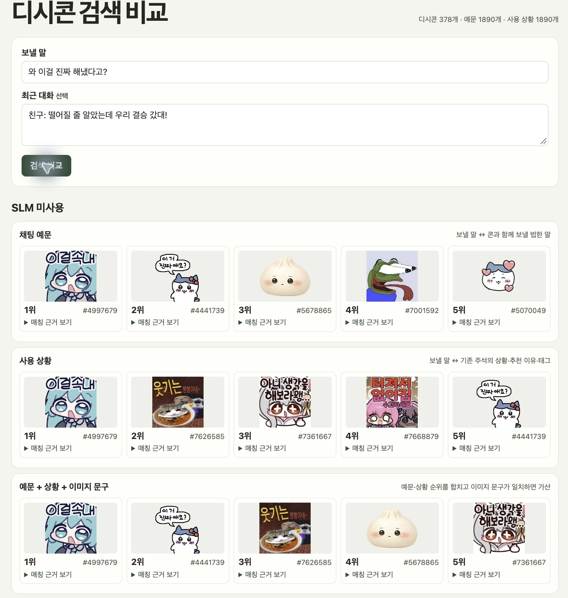
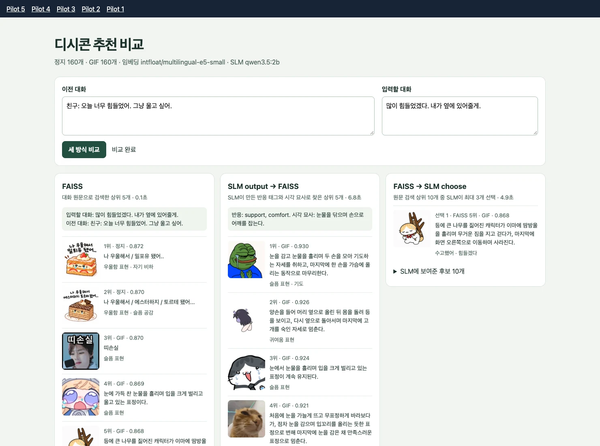
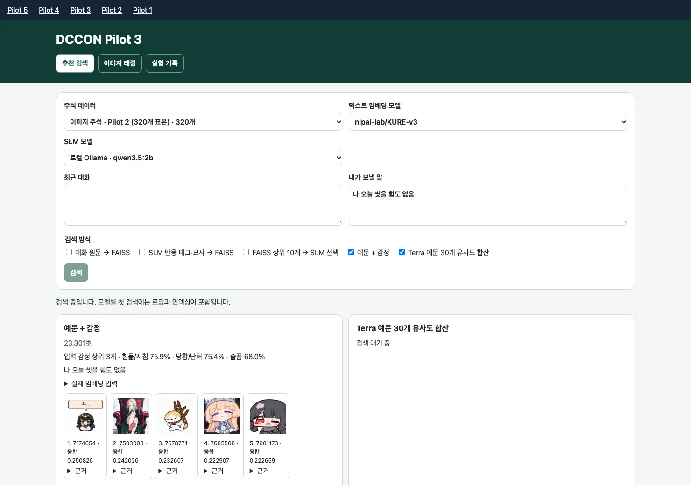
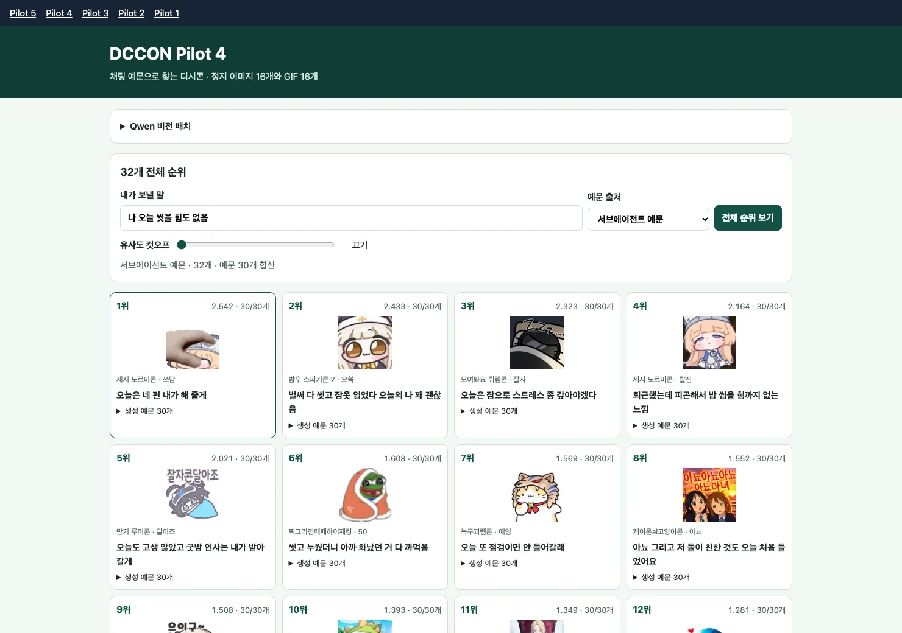
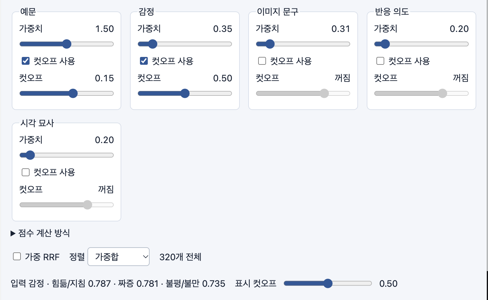
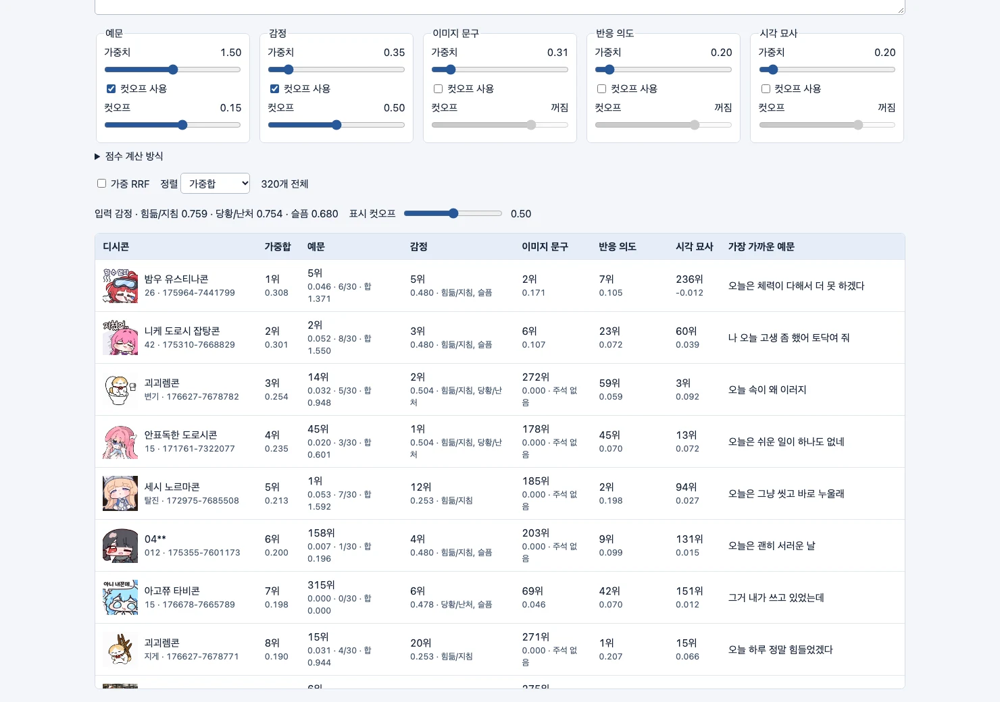

# DCCON sticker recommendation · Pilots 1–5

These pilots tested how to recommend a DCCON sticker for a Korean chat message. We started with a weekly crawl of 100 packages containing 8,245 sticker records and 8,218 downloaded images. The experiments used smaller subsets and reviewed individual search results. We have no human-rated relevance benchmark or accuracy scores for the five pilots.

| Pilot | Sticker set | Ranking approach | Main observation |
| --- | --- | --- | --- |
| 1 | 378 stickers with synthetic annotations | Eight routes spanning text similarity, conversation context, SigLIP 2 image search, and SLM-generated queries | The same reply could produce different recommendations with different prior messages. Raw similarity sometimes reversed the intended reaction. |
| 2 | 32-image trial, expanded to 320 stickers across 100 packages | E5/FAISS on vision annotations, with optional SLM query rewriting or selection from the first 10 candidates | Rewriting sometimes found a better contextual match. Candidate selection sometimes chose an unsuitable sticker even when an empty result was allowed. |
| 3 | Earlier sets in one interface, with 9,600 chat examples for the 320-sticker set | E5 or KURE-v3 text retrieval, chat-example similarity sums, and an example-plus-emotion mode | Both text encoders returned results. The example and emotion views made it possible to inspect the text and tags behind a result. |
| 4 | 32 stickers individually reviewed by agents, with 30 chat examples each | KURE-v3 similarity sums with an optional per-example cutoff | A cutoff can sharply change which examples contribute. The same cutoff behaved differently with E5 and KURE-v3. |
| 5 | 320 stickers with image annotations, KOTE tags, and 30 chat examples each | Five independently scored signals combined by weighted sum or weighted reciprocal rank fusion | The full ranking shows how each signal contributes and can be re-sorted without running model inference again. |

## Pilot 1 · Search over synthetic annotations

We indexed descriptions, image text, example replies, and usage situations with multilingual E5-small. The browser compared eight routes: example, situation, fused, contextual, description, SigLIP 2, SLM reaction intent, and SLM visual description. SigLIP 2 used the first frame of each GIF. The two SLM routes used local `qwen3.5:2b`.

The screenshot shows the finals example. For “와 이걸 진짜 해냈다고?” (“Wait, you actually pulled this off?”), description search ranked an apologetic sticker first. A manually written admiration/congratulations query ranked “천재인감!!” (“Are you a genius?!”) first. The file recovery and late-friend trials also changed the leading results of context-aware routes for the same draft, “됐어 ㅋㅋ,” whose meaning depends on the prior message.

[Experiment notes and context-pair screenshots](../experiments/pilot1/2026-11-23-search-experiments.md)

## Pilot 2 · Image annotations and SLM comparison

Groq-hosted Qwen annotated 160 still images and 160 GIFs with visible text, visual descriptions, reaction intent, evidence, and uncertainty. For GIFs it received five frames sampled across playback. E5/FAISS indexed the image text, reaction intents, and visual descriptions. We compared raw conversation retrieval, local Qwen query rewriting followed by retrieval, and local Qwen selection of up to three results from the raw top 10.

Across eight synthetic chats, the recorded median times were 0.1 s for direct search, 4.5 s for rewriting, and 8.3 s for candidate selection. In the recorded comfort example, rewriting put a hugging GIF third, while the selector picked a rude sticker first. The selector returned at least one sticker for all eight inputs, including a room-and-time announcement. A separate 24-query A/B run changed the rankings with Korean-tuned E5 and gave mixed results on slang.

The screenshot shows a separate comfort trial. The draft was “많이 힘들었겠다. 내가 옆에 있어줄게” (“That sounds really hard. I'll be here for you”). Raw retrieval surfaced mostly sadness. The rewritten query surfaced a comforting head-pat GIF at rank 5, and the selector returned one sticker, a character carrying a heavy load, from raw rank 5.

[Experiment notes](../experiments/pilot2/EXPERIMENTS.md) · [320 image annotations](../experiments/pilot2/results/annotations-320.jsonl) · [E5 comparison results](../experiments/pilot2/results/embedding-ab.json)

## Pilot 3 · Unified interface, example search, and emotion

The interface brought the earlier search modes and annotation tools together and added a switch between E5-small (384 dimensions) and KURE-v3 (1,024 dimensions). For the 320-sticker corpus, GPT-6.1 Terra generated 30 Korean chat examples per sticker. Example search ranked each sticker by the sum of its 30 cosine similarities and showed the closest example.

The example-plus-emotion mode added a KOTE tag-match bonus to text similarity. In the recorded “와 드디어 해냈다! 너무 기뻐 ㅋㅋ” trial (“I finally did it! I'm so happy”), KOTE returned excitement, joy, and happiness, and all five results carried those tags. The tags were selected from existing annotations, so this was a check of how the bonus affected retrieval. The Groq recommendation integration was exercised with mocked responses in the original pilot. The image annotation batch had already run against the live service.

The screenshot shows the example-plus-emotion results for “나 오늘 씻을 힘도 없음” (“I don't even have the energy to shower today”) with KURE-v3. KOTE scored tiredness at 75.9%, embarrassment at 75.4%, and sadness at 68.0%. These are classifier outputs for the input, and multiple labels can score highly at once. The separate Terra example-sum panel was still loading when the screenshot was taken.

[Setup and search modes](../experiments/pilot3/README.md) · [Terra chat examples](../experiments/pilot2/results/terra-examples-320.jsonl)

## Pilot 4 · Image-reviewed examples and cutoff

Three agents individually inspected 16 still images and 16 GIF frame strips and wrote 960 examples. The browser exposes all 32 ranks, each sticker's closest example, and the number of examples counted in its score. The optional cutoff excludes example similarities below the selected threshold before summing. A separate Qwen vision generation path was added, and the documented 32-sticker batch stopped after saving two checkpoints.

In the earlier “나 먼저 자러 감 다들 잘자” trial (“I'm going to bed first. Good night, everyone”), E5 put a goodnight sticker first. At a cutoff of 0.85, E5 counted 53 examples across the corpus and KURE-v3 counted zero. The raw similarity threshold depends on the encoder's score distribution.

The screenshot uses “나 오늘 씻을 힘도 없음” (“I don't even have the energy to shower today”) with KURE-v3, the image-reviewed examples, and the cutoff off. The first sticker's closest example offers to take over for someone who is tired.

[Setup and scoring](../experiments/pilot4/README.md) · [Image-reviewed examples](../experiments/pilot4/results/subagent-examples-32.jsonl)

## Pilot 5 · Weighted ranking over 320 stickers

Pilot 5 combines Terra chat examples, KOTE emotion overlap, image text, reaction intent, and visual description. It uses KURE-v3 at 1,024 dimensions for text similarity and the KOTE classifier for the input's top three emotions. The configuration below follows the supplied screenshot and is the starting configuration in the interface.

| Signal | Score | Weight | Scoring cutoff |
| --- | --- | ---: | ---: |
| Chat examples | Sum of qualifying cosine similarities divided by 30 | 1.50 | 0.15 |
| Emotion | Sum of qualifying probabilities from the input's top three emotions that match the sticker's tags, divided by 3 | 0.35 | 0.50 |
| Image text | Highest cosine similarity among the sticker's image-text strings | 0.31 | Off |
| Reaction intent | Highest cosine similarity among annotated reaction intents | 0.20 | Off |
| Visual description | Cosine similarity of the visual description | 0.20 | Off |

The initial sort is **weighted sum**, with weighted RRF **off** and all **320** stickers shown. The input-emotion display cutoff is **0.50** and controls the labels shown above the table. The emotion scoring cutoff operates separately. A missing signal or a signal with no qualifying scores contributes zero to the weighted sum.

With the same tiredness draft used in Pilot 4, the first-ranked sticker scored 0.308 overall. It ranked fifth on chat examples with 6 of 30 examples above the cutoff, and second on image text. Its closest example was “오늘은 체력이 다해서 더 못 하겠다” (“I'm out of energy and can't do any more today”). The third result was a toilet-themed sticker. Its emotion score reflected both tiredness and embarrassment, illustrating how a shared emotion can lift a result whose context differs from the draft.

[Setup and scoring](../experiments/pilot5/README.md)

## How to read the comparison

Pilot 1 uses a different corpus from Pilot 2, and Pilot 4 uses a 32-sticker subset with independently written examples. Pilot 3 and Pilot 5 share Terra's 320-sticker example corpus. The case studies and screenshots illustrate retrieval behavior on selected inputs. The pilots used different corpora, scoring scales, and query paths, so ranks and scores in these examples do not establish an overall winner.
