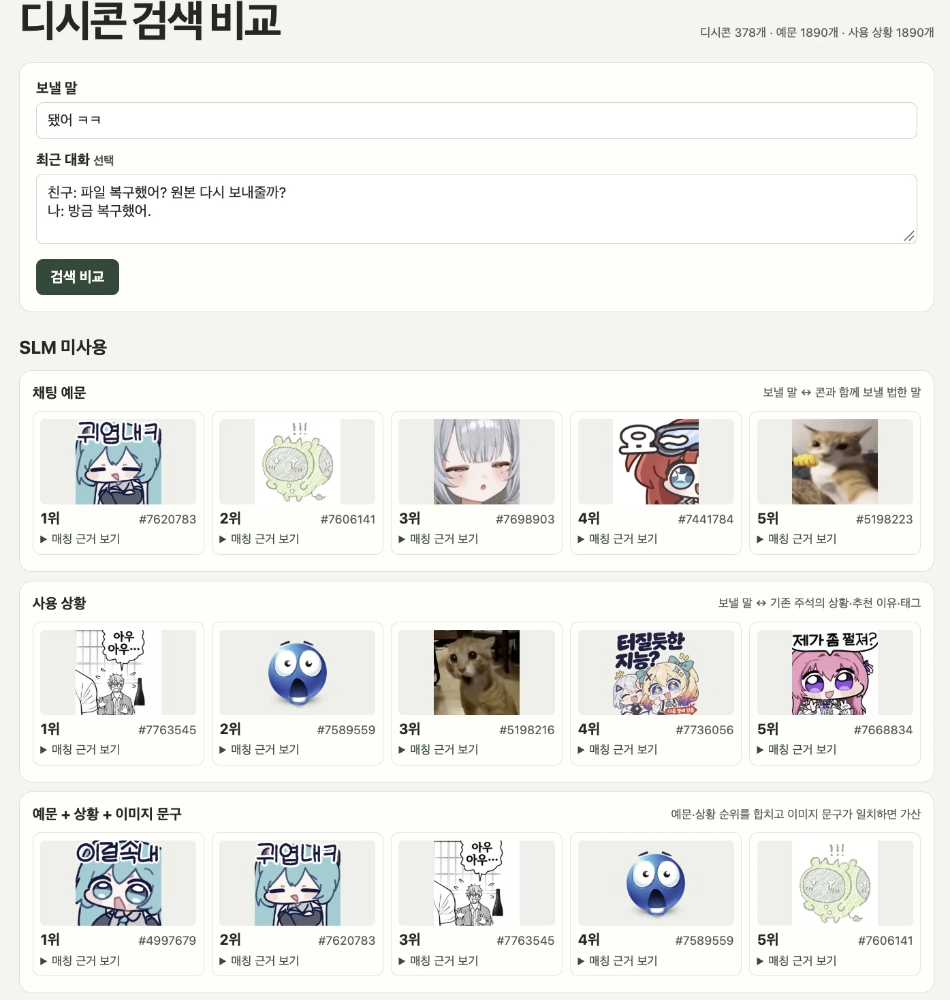
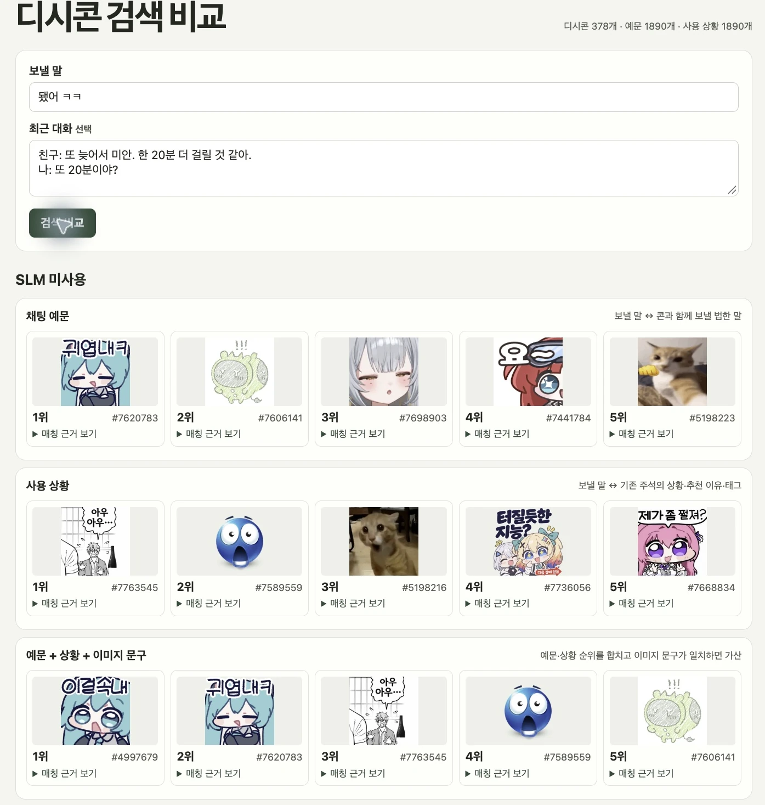
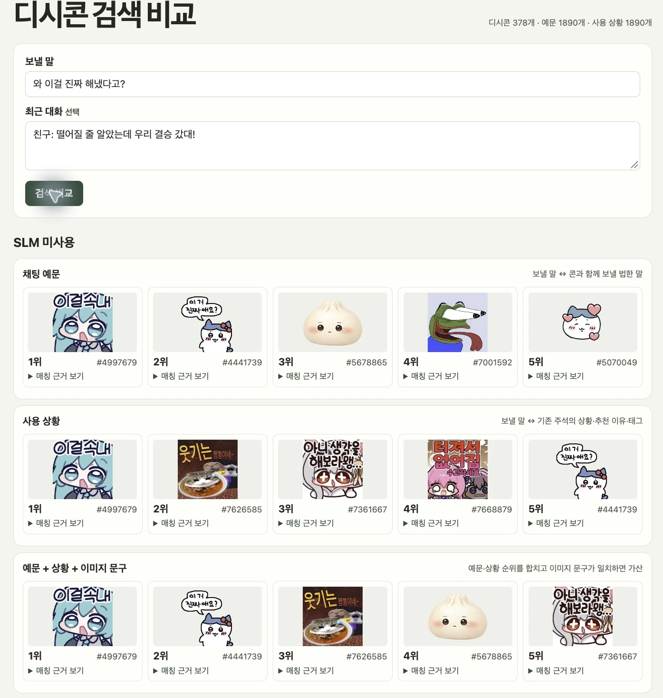
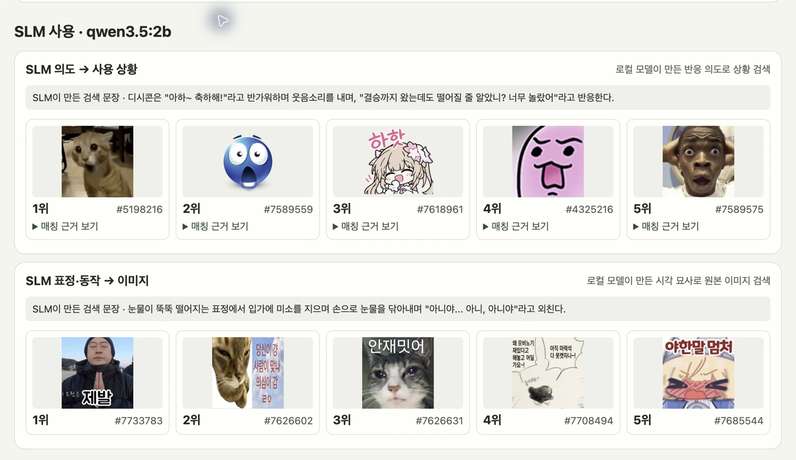

# 2026-11-23 디시콘 검색 실험 기록

보내려는 채팅 문장에 어울리는 디시콘을 찾기 위해 기존 합성 주석 378개와 원본 이미지 378개로 실험했다. 검색할 때 소형 언어 모델(SLM)을 호출하지 않아도 쓸 만한 결과가 나오는지 보기 위해 같은 입력으로 여러 방식을 비교했다.

## 오늘 시도한 것

처음에는 `multilingual-e5-small`로 콘마다 설명 벡터 하나를 만들었다. 이미지 설명, 이미지 속 문구, 사용 태그를 한 문서로 합치고, 정규화된 벡터를 FAISS에서 내적으로 비교했다. Tk 창을 띄울 때 Python 프로세스가 종료돼 로컬 HTTP 서버와 브라우저 UI로 바꿨다.

이미지 설명과 채팅 문장 사이의 차이를 줄이려고 `sticker_message.text`도 검색 대상으로 넣었다. 이후 사용 상황을 용례마다 따로 임베딩하고, 채팅 예문·상황 검색 순위에 이미지 속 문구 일치를 더하는 방식까지 구현했다. 예문과 사용 상황 인덱스에는 각각 1,890개 항목이 들어갔다.

원본 이미지 검색은 SigLIP 2(`google/siglip2-base-patch16-224`)로 실험했다. 투명 영역을 흰색 배경에 합성했고, 움직이는 콘은 첫 프레임을 사용했다. 채팅 원문으로 바로 검색해 보고, 사람이 작성한 표정·동작 설명으로 같은 인덱스를 검색한 뒤, Ollama의 `qwen3.5:2b`가 해당 설명을 생성하도록 연결했다. SLM이 만든 반응 의도를 E5 사용 상황 검색에 넣는 경로도 추가했다.

## 최종 비교 화면

입력은 보낼 말과 최근 대화 두 칸이다. 최근 대화는 선택이며, 이미지 검색과 SLM 결과는 서버 실행 옵션에 따라 표시된다. 각 방식은 상위 5개를 보여주고 매칭된 예문, 상황, 문구 또는 생성된 검색 문장을 확인할 수 있다.

| 방식 | 검색 입력과 대상 |
| --- | --- |
| 채팅 예문 | 보낼 말 → `sticker_message.text`의 E5 벡터 |
| 사용 상황 | 보낼 말 → 용례별 `context`, `fit_reason`, `usage_tags`를 합친 E5 벡터 |
| 예문·상황·이미지 문구 결합 | 예문과 상황의 상위 20개에서 역순위 점수를 더하고, 보낼 말에 주석의 이미지 문구가 포함되면 점수를 한 번 더 부여 |
| 최근 대화 포함 | 최근 대화와 보낼 말을 그대로 붙여 E5 사용 상황 검색 |
| 기존 이미지 설명 | 보낼 말 → 콘당 이미지 설명·이미지 문구·사용 태그를 합친 E5 벡터 |
| 원본 이미지 | 보낼 말 → SigLIP 2 텍스트 인코더 → 원본 이미지 벡터 |
| SLM 반응 의도 | 최근 대화와 보낼 말 → Qwen3.5-2B가 만든 반응 의도 → E5 사용 상황 검색 |
| SLM 표정·동작 | 최근 대화와 보낼 말 → Qwen3.5-2B가 만든 시각 묘사 → SigLIP 2 이미지 검색 |

예문과 사용 상황 검색에서 같은 콘의 용례가 여러 번 나오면 최고 점수 용례를 사용한다. 문구 일치는 기존 주석의 `image_text`를 정규화해 비교한다.

## 확인한 결과

- 초기 설명 검색에서 `와 이걸 진짜 해냈다고?`의 1위는 `죄송해요...`였다. 사람이 `예상 밖의 성공에 감탄하고 축하하는 리액션`으로 바꿔 검색했을 때는 `천재인감!!`가 1위였다.
- `지금 말 걸지 마 나 한 문제 남음`의 예문 검색 1위는 `말 걸지 마 한 개 더 집는 중`이었다. 표현은 비슷했지만 문제를 푸는 데 집중하고 있다는 상황이 순위에 충분히 반영되지 않았다.
- SigLIP 2에서 감탄 문장을 표정·동작 설명으로 바꾸자 신이 난 캐릭터가 1위로 나왔다. 집중하는 모습을 설명한 쿼리에서는 화난 캐릭터가 1위였다.
- `됐어 ㅋㅋ`를 파일 복구 상황과 친구가 또 지각하는 상황에 각각 넣었을 때 Qwen3.5-2B가 만든 설명과 이미지 검색 1위가 달라졌다. 파일 복구 사례에서는 `[웃는 얼굴] "ㅋㅋ"`로 바뀌며 안도나 도움을 사양하는 뜻이 빠졌다. 프롬프트 예시를 그대로 반복해 예시 문장을 뺐고, 최종 비교에서도 반응 의도 대신 지시를 되풀이한 사례가 있었다.
- 결승 진출 대화와 `와 이걸 진짜 해냈다고?`를 입력해 API와 브라우저에서 8가지 방식이 각각 5개 결과를 표시하는 것을 확인했다. 이는 동작 확인과 소수 사례 관찰이다. 방식별 추천 품질이나 우열은 별도 평가가 필요하다.

## 데이터셋 설계에서 논의한 것

원본 이미지와 크롤러 매니페스트를 유지하고, 관찰 가능한 정보(이미지 문구, 외형, GIF 동작)와 해석이 필요한 정보(반응, 말투, 사용 상황)를 별도 필드에 두는 구조를 논의했다. 콘 하나에 여러 채팅 예문과 용례를 연결하고, 모델로 생성한 주석에는 모델 ID, 프롬프트 버전, 입력 이미지 해시, 사용 프레임, 검토 상태를 기록하는 안이다.

Groq 비전 모델로 40장 태깅, KURE-v1 임베딩 비교, GIF 여러 프레임 활용, 후보 재정렬 모델 학습은 후속 실험으로 논의했다. 평가용 채팅 30~50개를 예문과 별도로 작성하고, 한 입력에 어울리는 콘을 여러 개 허용해 상위 5개 결과를 사람 기준으로 판정하는 방식도 제안했다.

## 실행

E5·FAISS 검색 환경에서 저장소 루트 기준으로 실행한다. 이미지 검색에는 Pillow, PyTorch, Transformers와 SigLIP 2 모델이 필요하다. SLM 경로에는 로컬 Ollama 서버와 설치된 모델이 필요하다. 이미지 미리보기와 임베딩에는 주석의 이미지 경로에 대응하는 원본 데이터가 필요하다.

```sh
python experiments/pilot1/sticker_gui.py --image-search --ollama-model qwen3.5:2b
```

기본 주소는 `http://127.0.0.1:8765/`다. 텍스트 검색만 비교할 때는 두 옵션을 생략한다. 기본 주석·데이터 경로를 바꾸려면 `--annotations`와 `--dataset`을 지정한다.

## 브라우저 재테스트와 스크린샷

합성 채팅 3건을 비교 화면에 직접 입력했다. 콘 378개, 예문과 사용 상황 각 1,890개, 이미지 378개를 인덱싱한 환경이었다. 세 건 모두 8가지 방식에서 각각 서로 다른 콘 5개가 표시됐다. 아래 표의 숫자는 각 방식의 1위 스티커 ID다.

| 검색 방식 | 파일 복구 | 친구 지각 | 결승 진출 |
| --- | --- | --- | --- |
| 채팅 예문 | 7620783 | 7620783 | 4997679 |
| 사용 상황 | 7763545 | 7763545 | 4997679 |
| 예문·상황·이미지 문구 결합 | 4997679 | 4997679 | 4997679 |
| 최근 대화 포함 | 7736056 | 5678874 | 5677881 |
| 기존 이미지 설명 | 7684215 | 7684215 | 7760475 |
| 원본 이미지 | 7708519 | 7708519 | 7654383 |
| SLM 반응 의도 | 7736056 | 6169588 | 5198216 |
| SLM 표정·동작 | 6425745 | 7708494 | 7733783 |

### 파일 복구 · 됐어 ㅋㅋ

원본을 다시 보내겠다는 제안에 이미 복구했다고 답한 상황이다. SLM은 웃음 표현을 길게 설명했고, 안도나 도움을 사양한다는 뜻은 검색 문장에 드러나지 않았다.



### 친구 지각 · 됐어 ㅋㅋ

같은 답장에 친구가 20분 더 늦는다는 앞 대화를 넣었다. 답장만 쓰는 다섯 방식의 1위는 파일 복구 사례와 같았다. 최근 대화를 직접 넣는 검색과 두 SLM 방식의 1위는 모두 달라졌다. SLM의 반응 의도에는 지각 상황과 무관한 `뚱뚱`이 나왔다.



### 결승 진출 · 와 이걸 진짜 해냈다고?

예상 밖의 결승 진출에 놀라는 상황이다. 예문·상황·결합 검색은 같은 콘을 1위에 올렸다. SLM은 반응 의도에 놀람과 축하를 담았고, 표정·동작 설명에는 눈물을 닦으며 `아니야`라고 외치는 장면을 넣었다. 1위가 달라진 것만으로 맥락 사용이 추천 품질을 높였는지는 판단하기 어렵다.




